# Báo cáo tiến độ nghiên cứu ngày 10/10/2026
## A. Công việc đã làm
- Đồ thị khi không tác động mạch mới
- Đồ thị khi không tác động mạch cũ
- Đồ thị lực tác động vào giữa 4 chân
## B. Khó Khăn
## C. Báo cáo chi tiết 
### 1. Phần cứng hoàn chỉnh

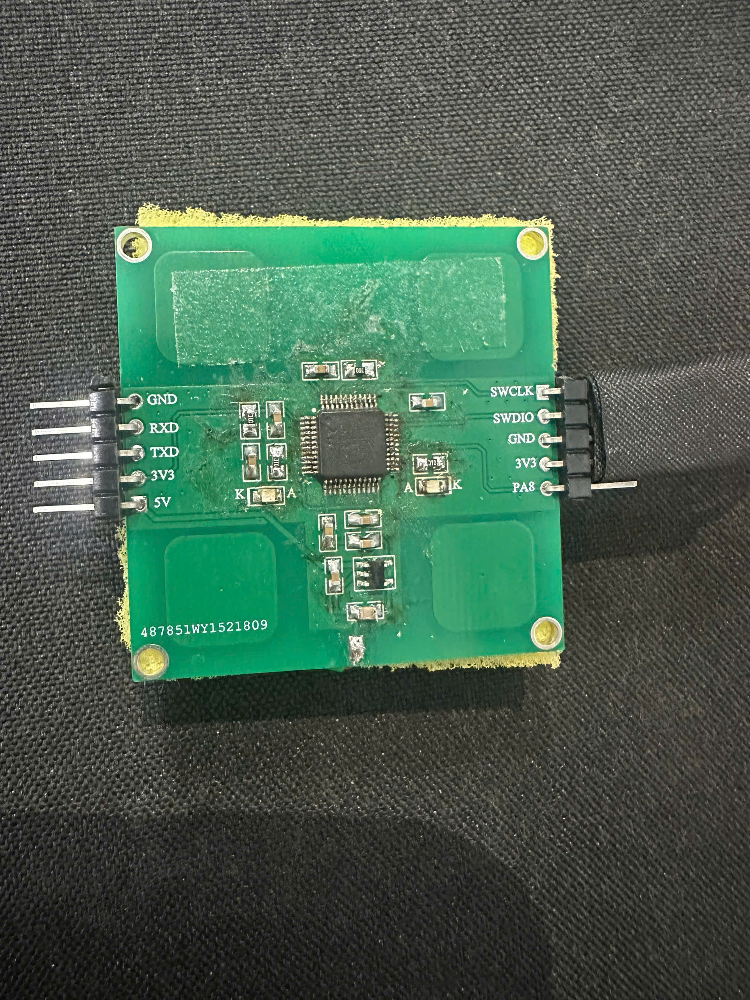

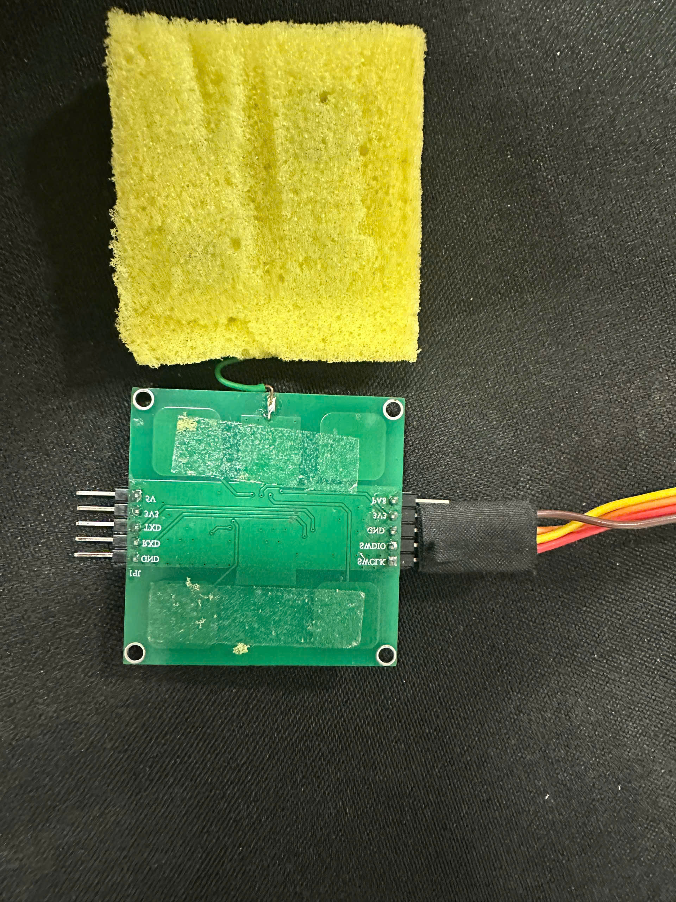

  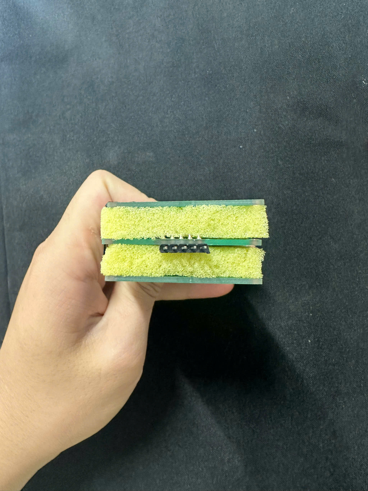
  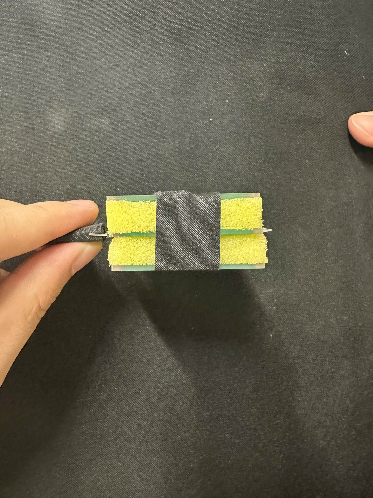
  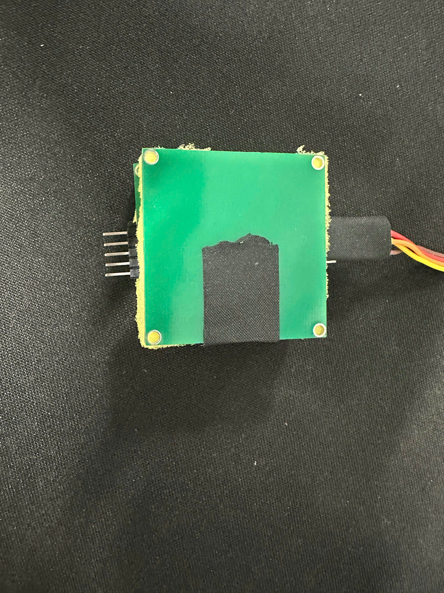

### 2. Đồ thị khi không tác động mạch mới
- Ta đo 89 mẫu để thời gian đo 4 pad bằng đúng 80ms.
- Khi không tác động gì, theo thời gian thì giá trị vẫn thay đổi.
- Hình ảnh khi đo

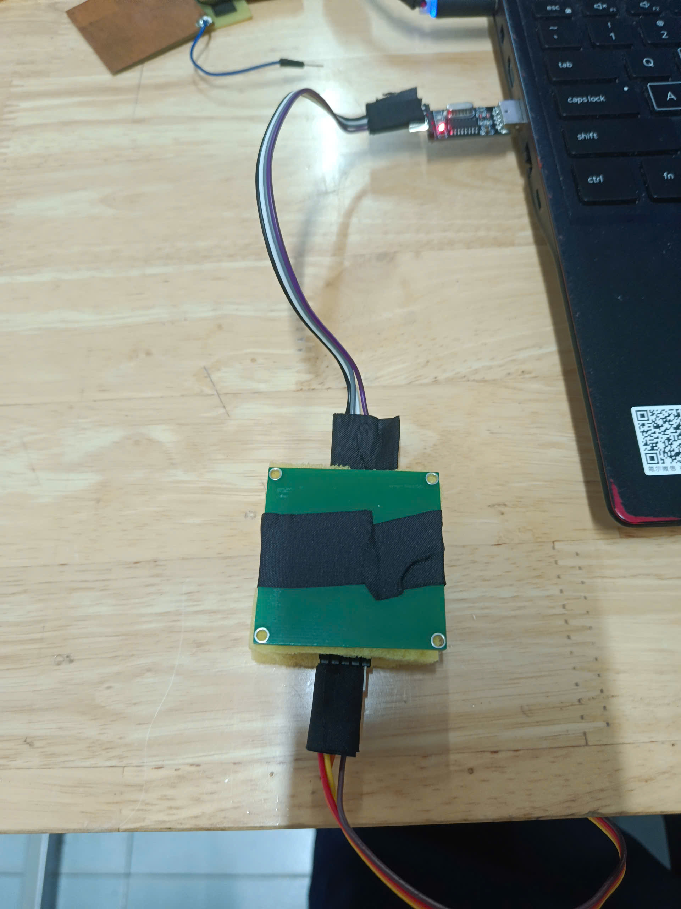

- Tiến hành đo 5 lần
#### Lần 1

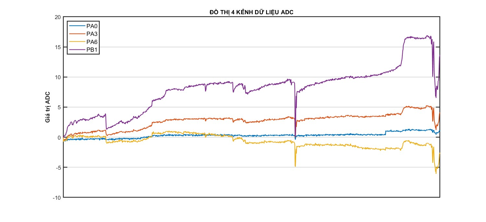

##### Nhận xét
- PA0: ổn định nhất
- PA3: trôi nhẹ theo chiều dương
- PA6: trôi nhẹ theo chiều âm
- PB1: trôi mạnh nhất theo chiều dương

#### Lần 2

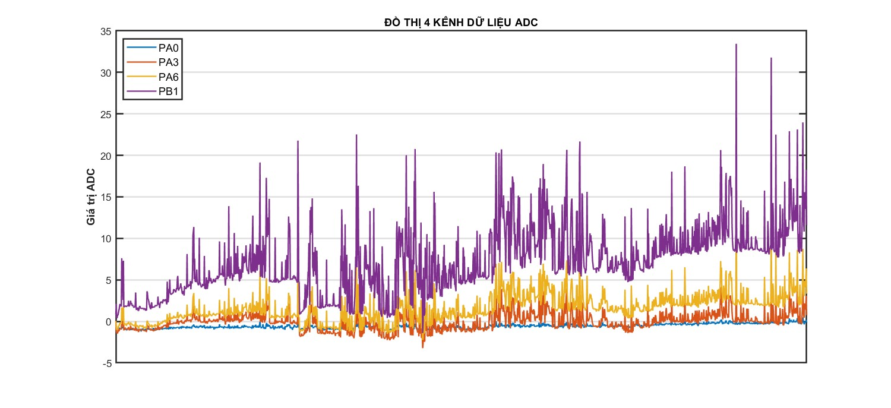

##### Nhận xét:
- Xuất hiện nhiều gai nhọn

#### Lần 3

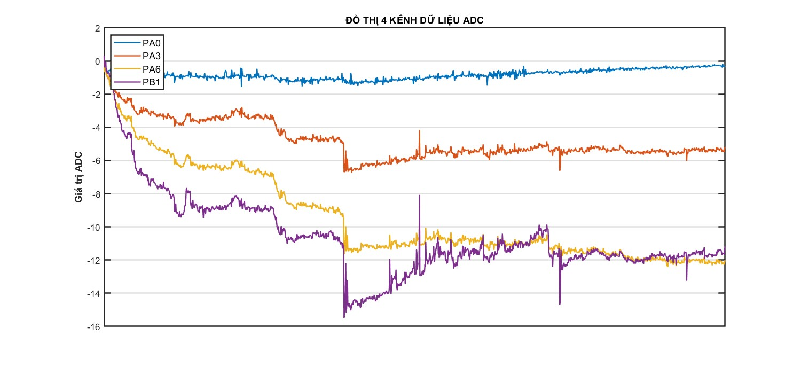

##### Nhận xét:
- PA0: vẫn ổn định
- 3 chân còn lại bị trôi mạnh về chiều âm

#### Lần 4

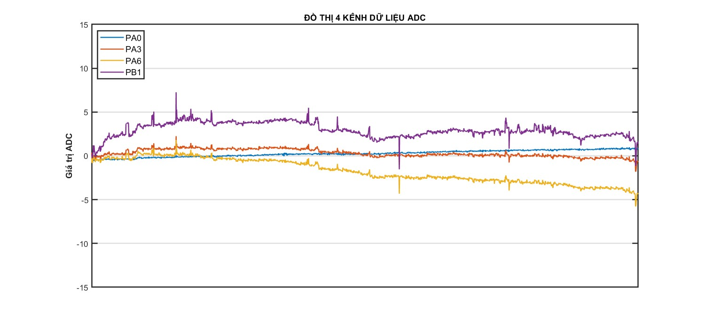

##### Nhận xét
- ổn định
- các chân bị trôi ít

#### Lần 5

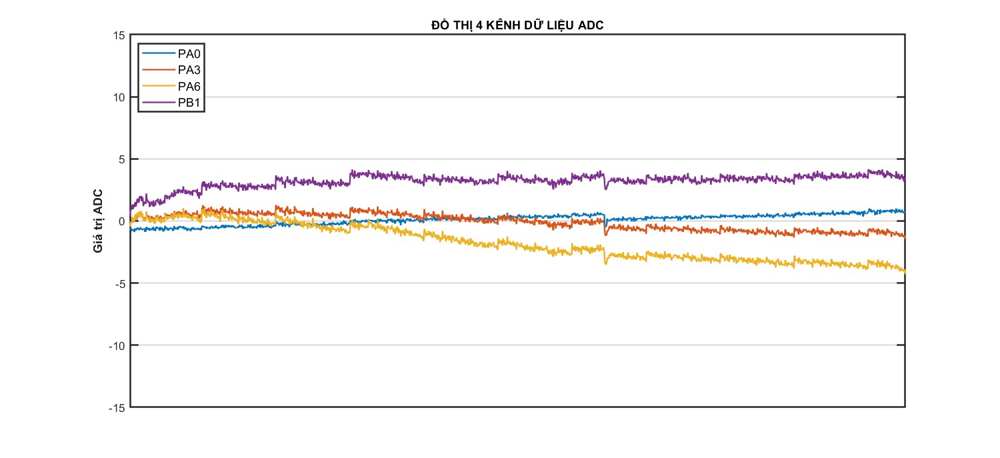

##### Nhận xét
- PA0, PA3 khá ổn định
- PA6 trôi nhẹ theo chiều âm
- PB1 trôi nhẹ theo chiều dương

### 3. Đồ thị khi không tác động mạch cũ
- Ta nạp code giống hệt code mạch mới
- Hình ảnh khi đo

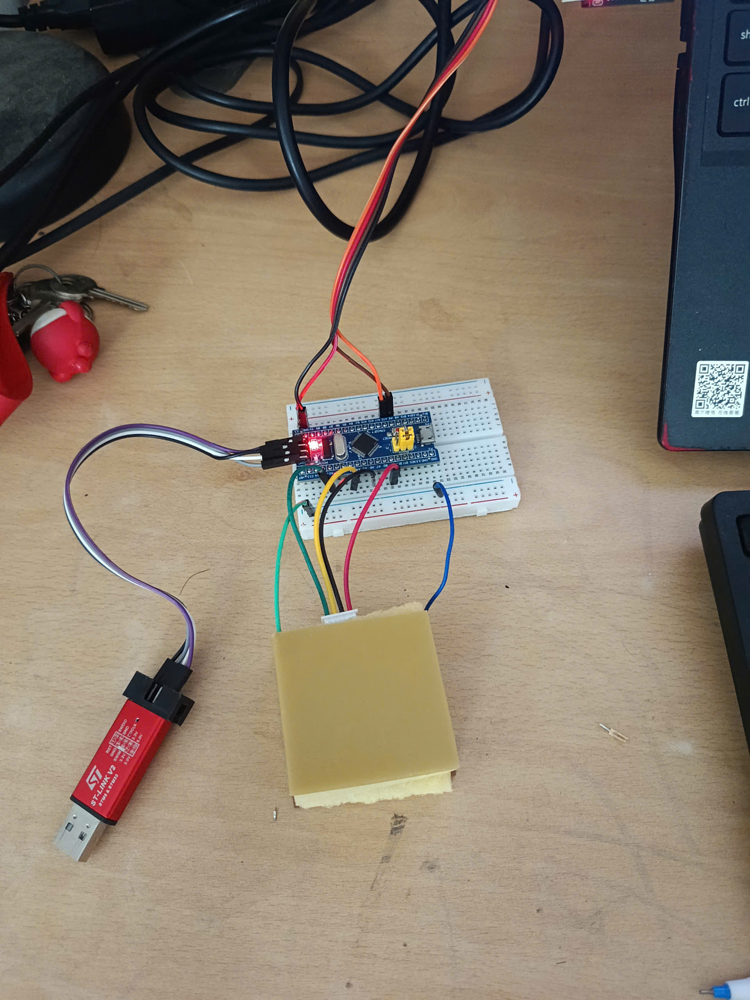

- Tiến hành đo 3 lần
#### Lần 1

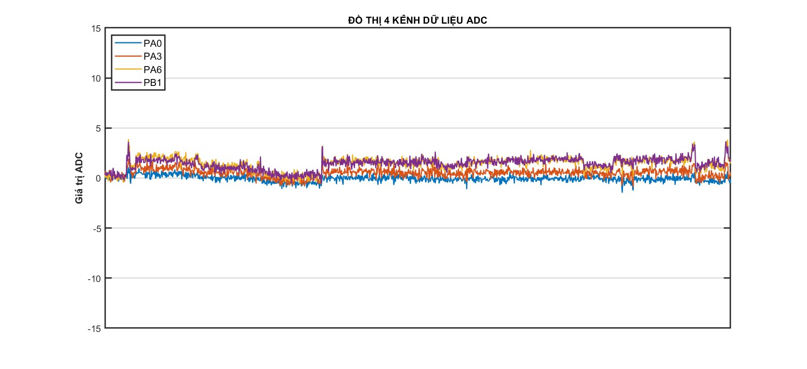

##### Nhận xét
- 4 chân đo ổn định theo thời gian
#### Lần 2

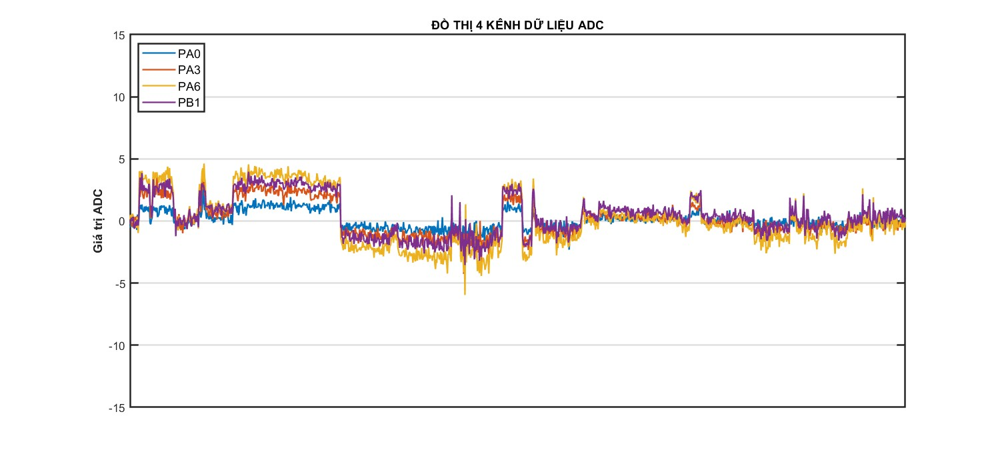

##### Nhận xét
- 4 chân đo khá ổn định, có đoạn bị lệch nhưng không đáng kể

#### Lần 3

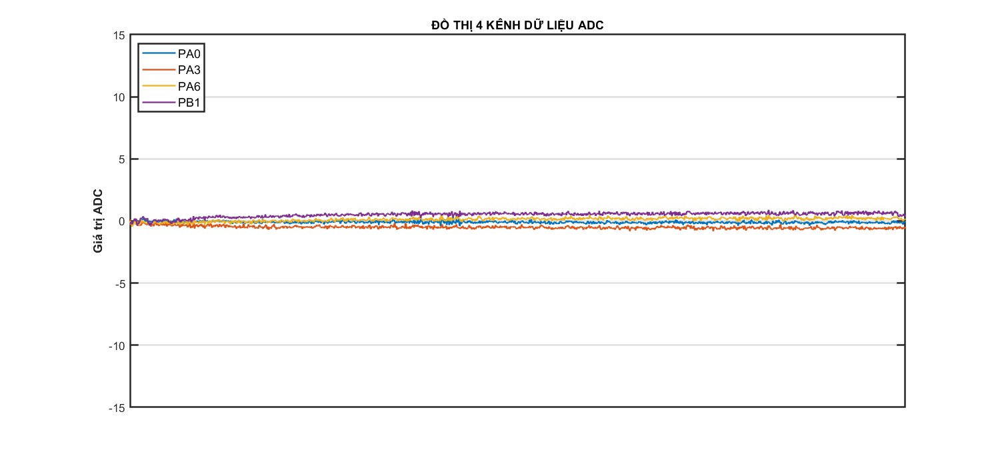

##### Nhận xét
- 4 chân đo ổn định theo thời gian

### 4. Đồ thị đo lực 4 chân

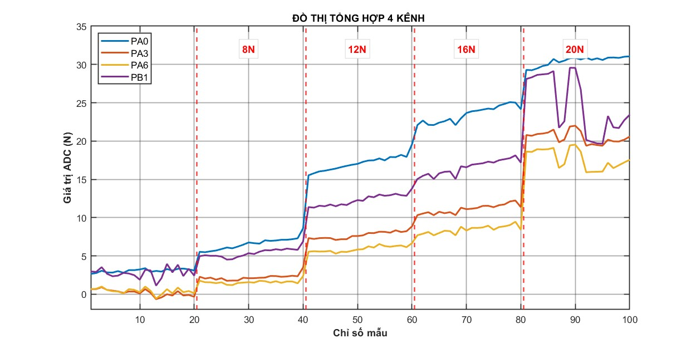

